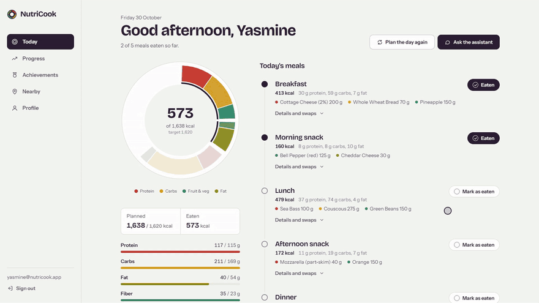
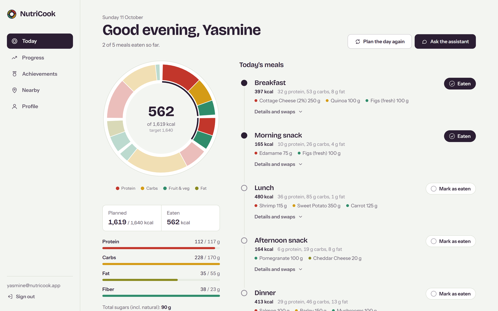
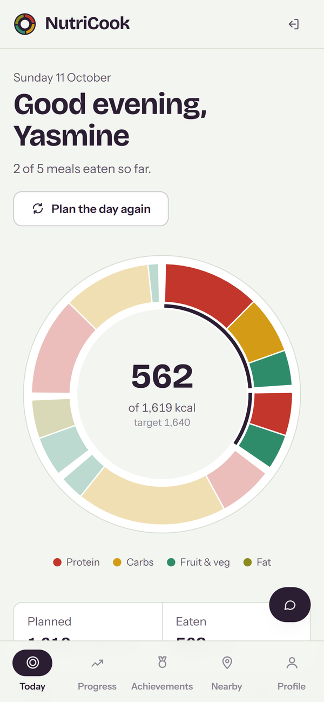
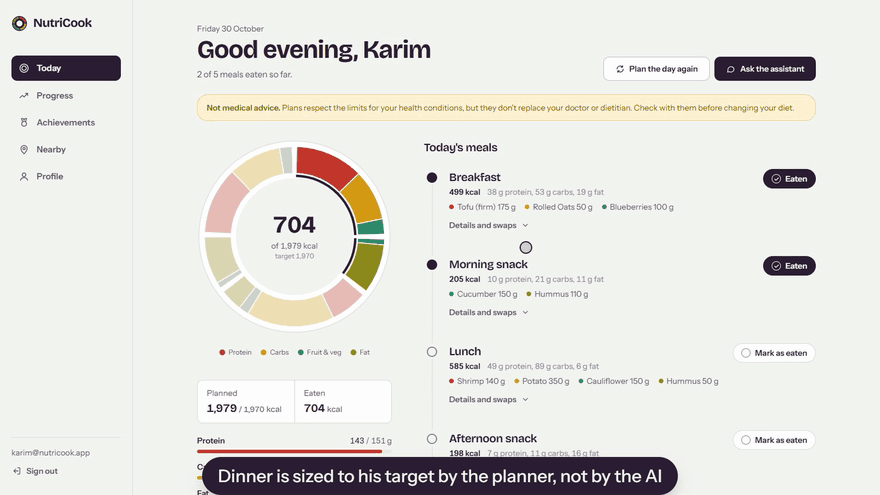
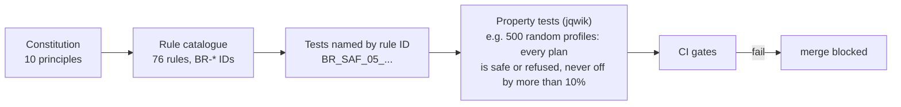
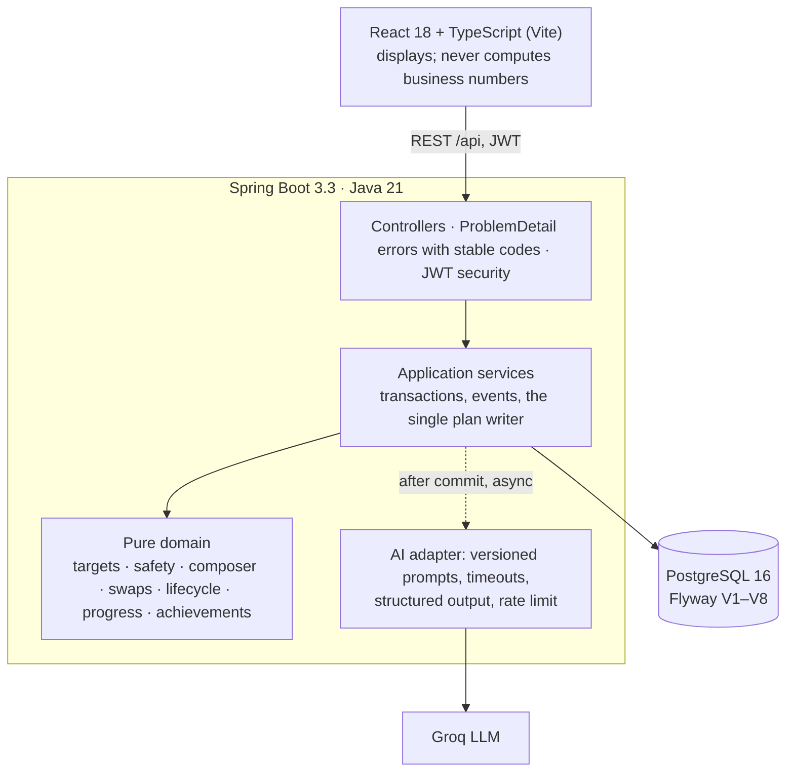

# NutriCook — a diet planner whose rules you can audit

[](https://github.com/anassoooo/NutriCook/actions/workflows/ci.yml)

NutriCook builds a personal daily meal plan from your profile, your allergies, your diet and your
health conditions. You can then swap foods, check off what you ate, and track your progress. The
plan is computed by a deterministic, tested domain core. An LLM (Groq, GPT-OSS 120B) only explains
the plan and proposes changes, and the domain validates every proposal before anything is saved.
Every business rule has an ID, a written definition and at least one test named after it, and CI
fails if a rule loses its test.

**Live demo:** [nutricook-pied.vercel.app](https://nutricook-pied.vercel.app). The backend runs on a
free plan that sleeps when idle, so the first request can take about a minute.



---

## What it does

| | |
|---|---|
| **Targets** | Calories from Mifflin-St Jeor and activity, a goal adjustment and a safety floor; protein, fat, carbs and fiber per kg and per energy share |
| **Safe plans** | 5 meals from an 84-food USDA-based catalog. Allergens (the EU's 14), diets (vegan, vegetarian, halal, kosher) and condition limits (sugar, fat, sodium) are enforced; unknown data is excluded, never guessed |
| **Deterministic** | The same user, day and generation give the same plan (seeded composer). A plan within ±5% of its target is accepted, up to ±10% carries a warning, beyond that it is never shown |
| **AI that cannot break rules** | The explanation and tips arrive asynchronously, so the plan never waits for the AI. The chat can only propose foods the user may eat; numbers written by the AI are never stored |
| **Plan changes** | Same-role food swaps, from a menu or from the chat. Regenerating keeps exactly one active plan per day; past and archived plans are read-only |
| **Progress** | Check off meals to count calories automatically, or type your own. Logging a weight updates your profile and future targets |
| **Achievements** | Streaks with an end-of-day grace period, days within 10% of the day's own target, hydration, and weight change in your goal's direction. Awarded once, never revoked |
| **Catalog admin** | Admins add and edit foods behind a quality gate (energy must match the macros, labels must match the food); foods are deactivated, never deleted |
| **Nearby food** | Restaurants and stores from OpenStreetMap |

---

## Screenshots

<p>
  
  
</p>

---

## The assistant proposes, the domain decides



The chat runs on Groq (GPT-OSS 120B) through Spring AI. The model never changes a plan directly:

- **Only safe foods reach the prompt.** The candidate list is built from the user's allergies,
  diet and conditions, and any food the model names outside it is refused (BR-AI-02).
- **User text is data.** It is wrapped in delimiters and capped at 500 characters (BR-AI-06).
- **Structured output.** The reply is parsed into a typed intent, retried once on bad JSON, then
  shown as plain text (BR-AI-04).
- **The domain does the maths.** A proposed swap is re-portioned to the meal's target and re-checked
  by the same safety validator as a manual swap; numbers in the reply are never stored (BR-AI-01,
  BR-AI-03).
- **Failures degrade.** A 10-second timeout or a provider error returns `AI_UNAVAILABLE`, never a
  500, and each user can send 30 messages per hour (BR-AI-05, BR-AI-07).

[`ChatServiceIT`](backend/src/test/java/com/nutricook/service/ChatServiceIT.java) tests each rule
against a scripted fake model that misbehaves on purpose: it suggests peanut butter to a user with a
nut allergy, claims "9999 kcal", sends broken JSON, times out and fails.

---

## How correctness is guaranteed



1. **Rules are written first.** [`docs/domain/business-rules.md`](docs/domain/business-rules.md)
   defines each rule (`BR-SAF-05`: nothing unsafe is ever saved; `BR-PRG-04`: the latest weigh-in
   updates the profile; and so on), with its error code and configurable constants. When the code
   and the catalogue disagree, the code is wrong until the catalogue is amended; the amendment
   log records every change.
2. **Each rule has a test that carries its ID.** For example, `BR_ACH_01_streakGraceUntilEndOfDay`
   tests BR-ACH-01. [`scripts/check-br-coverage.sh`](scripts/check-br-coverage.sh) maps rules to
   tests, and CI fails if any rule has none.
3. **The domain is pure Java,** with no framework, no database and an injected clock, so rules are
   tested exhaustively: table-driven and property-based tests, plus Testcontainers integration
   tests on the real PostgreSQL 16. ArchUnit enforces the boundaries; for example, only
   `PlanCommandService` may save a plan, and it validates the plan first.
4. **CI gates.** Formatting, ≥ 90% line and ≥ 75% branch coverage in every domain package, ≥ 75%
   line coverage for services, rule-test coverage, a generated-catalog check, the frontend
   typecheck, lint and tests, and Docker image builds.
5. **The database defends itself too.** CHECK constraints, a partial unique index for "one active
   plan per day", and `INSERT … ON CONFLICT` for awards. Every migration is applied to existing
   data, not just to an empty database.

The constitution behind this is [`.specify/memory/constitution.md`](.specify/memory/constitution.md);
the plan and the 86 tasks that built it are in [`specs/001-reliable-core/`](specs/001-reliable-core).

---

## Architecture



More in [`docs/uml/`](docs/uml): [architecture and classes](docs/uml/class-diagram.md),
[data model](docs/uml/data-model.md), [sequence diagrams](docs/uml/sequence-diagrams.md) and
[use cases](docs/uml/use-case.md).

---

## Quickstart

Prerequisites: Docker Desktop. A free [Groq API key](https://console.groq.com) is optional:
without it everything works except the AI text.

```bash
git clone https://github.com/anassoooo/NutriCook.git
cd NutriCook
cp .env.example .env     # optional: set GROQ_API_KEY, and DEMO_ADMIN_PASSWORD for an admin account
docker compose up --build
```

| Service | URL |
|---|---|
| App | <http://localhost:8081> |
| API docs (Swagger UI) | <http://localhost:8080/swagger-ui.html> |
| PostgreSQL | `localhost:5433` (user and password `nutricook`) |

Register, complete the onboarding, and generate your first plan. With `DEMO_ADMIN_PASSWORD` set,
you can sign in as `admin@nutricook.local` (or your `DEMO_ADMIN_EMAIL`) to open the **Catalog**
page. Stop with `docker compose down`, adding `-v` to wipe the database.

### Developing without Docker for the app

Prerequisites: Java 21 and Node.js 24. The Maven wrapper is included.

```bash
docker compose up -d db                 # PostgreSQL only, on localhost:5433

cd backend && ./mvnw spring-boot:run    # Windows: mvnw.cmd spring-boot:run (local profile, :8080)
cd frontend && npm ci && npm run dev    # http://localhost:5173, proxies /api to :8080
```

---

## Testing

```bash
# Backend: format check, unit, property and integration tests (Testcontainers, needs Docker),
# coverage gates
cd backend && ./mvnw verify

# Frontend: types, lint, tests, production build
cd frontend && npm run typecheck && npm run lint && npm test && npm run build

# Every business rule has a test (exit 1 if not); the catalog migration matches foods.csv
bash scripts/check-br-coverage.sh --enforce
python scripts/gen-food-seed.py --check
```

The suite has about 370 backend tests and 54 frontend tests. Test names start with the rule they
cover: searching the code for `BR_SAF_05` finds every test of BR-SAF-05.

---

## Configuration

Every variable is described in [`.env.example`](.env.example). The main ones:

| Variable | Purpose |
|---|---|
| `GROQ_API_KEY` | AI text and chat (optional) |
| `JWT_SECRET` | Base64, ≥ 32 bytes (`openssl rand -base64 48`). The `prod` profile refuses weak or published secrets |
| `SPRING_PROFILES_ACTIVE` | `local` (backend on the host), `docker` (Compose) or `prod` |
| `DATABASE_URL`, `DATABASE_USERNAME`, `DATABASE_PASSWORD` | PostgreSQL connection |
| `CORS_ALLOWED_ORIGINS` | Browser origins allowed to call the API |
| `DEMO_ADMIN_EMAIL`, `DEMO_ADMIN_PASSWORD` | Local demo admin; never created in `prod` |

Business tunables (calorie floors, protein per kg, meal shares, tolerances, quotas) live under
`app.*` in [`application.yml`](backend/src/main/resources/application.yml). They are
range-checked at startup and documented in §13 of the rule catalogue.

Deployment to Neon, Render and Vercel (all free tiers) is described in
[`docs/deploy.md`](docs/deploy.md).

---

## Project structure

```text
NutriCook/
├── backend/                         Spring Boot API
│   └── src/main/java/com/nutricook/
│       ├── domain/                  pure business logic (no Spring): energy, safety, plan,
│       │                            progress, achievement, catalog, rules
│       ├── service/                 transactions and orchestration; PlanCommandService writes plans
│       ├── ai/                      PromptLibrary, structured chat intent
│       ├── controller/  dto/        REST API
│       ├── entity/  repository/     JPA
│       ├── security/  config/       JWT, CORS, request ids, startup checks
│       └── exception/               RFC 9457 ProblemDetail responses
│   └── src/main/resources/
│       ├── db/migration/            Flyway V1–V8 and the generated food catalog
│       ├── db/catalog/foods.csv     curated foods, the source of the catalog migration
│       └── prompts/                 versioned LLM prompts
├── frontend/                        React + TypeScript (Vite, Tailwind, Vitest)
├── docs/domain/business-rules.md    the 76 rules: the reference for behavior
├── docs/uml/                        architecture, data model, sequences, use cases
├── docs/deploy.md                   free-tier deployment
├── specs/001-reliable-core/         specification, plan and tasks
├── scripts/                         rule-coverage check, catalog generator
├── docker-compose.yml               the whole stack
└── render.yaml                      Render blueprint for the backend
```

---

## API overview

All endpoints under `/api/users/{userId}` require `Authorization: Bearer <token>` for that user.
Errors are RFC 9457 ProblemDetail bodies with a stable `code` (see §12 of the rule catalogue) and a
`requestId`. The full contract is in Swagger UI.

| Method | Endpoint | |
|---|---|---|
| POST | `/api/auth/register`, `/api/auth/login` | Account and JWT |
| GET, PUT | `/api/users/{id}/profile` | Profile; conditions and restrictions under `/health-conditions`, `/dietary-restrictions` |
| GET | `/api/users/{id}/targets` | Daily and per-meal targets, with how they were computed |
| POST | `/api/users/{id}/diet-plans/generate[?date=]` | Generate today's plan, or one up to 7 days ahead |
| GET | `/api/users/{id}/diet-plans[/{planId}]` | Plans |
| GET, POST | `…/diet-plans/{planId}/meals/{mealId}/alternatives`, `…/swap` | Safe swap options; swap a food |
| PUT | `…/diet-plans/{planId}/meals/{mealId}/completion` | Check a meal off |
| POST | `…/diet-plans/{planId}/chat` | AI dietitian |
| PATCH | `…/diet-plans/{planId}/archive` | Archive a plan |
| POST, GET | `/api/users/{id}/progress`, `/progress/weekly?start=&end=` | Log a day; read a range |
| GET | `/api/users/{id}/achievements` | Every achievement with your current value |
| GET | `/api/location/restaurants`, `/api/location/stores` | Nearby places (OpenStreetMap) |
| GET, POST, PUT, DELETE | `/api/admin/foods` | Catalog administration (ADMIN) |

---

## License

MIT, see [LICENSE](LICENSE).
