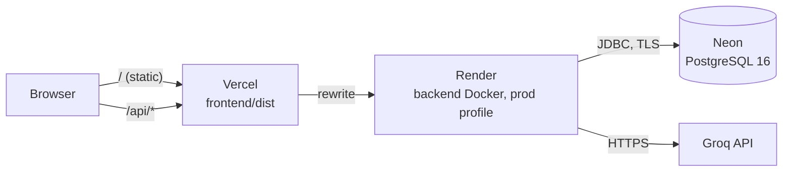

# Deploying NutriCook

Free tiers only (Constitution IX): **Neon** for PostgreSQL, **Render** for the backend container,
**Vercel** for the frontend. Vercel forwards `/api/*` to Render, so the browser talks to one
origin and the frontend needs no API URL.



Allow about 30 minutes for a first deployment.

---

## 1. Database: Neon

1. Create a project at <https://neon.tech> with **PostgreSQL 16**, in the region closest to your
   Render region.
2. Open **Connection details** and note the host, database, user and password. Neon shows a
   `postgresql://…` URL; the backend needs the JDBC form:

   ```text
   DATABASE_URL=jdbc:postgresql://<host>/<database>?sslmode=require
   DATABASE_USERNAME=<user>
   DATABASE_PASSWORD=<password>
   ```

Do not create any tables yourself. Flyway creates the schema and loads the reference data and the
food catalog on the first start.

## 2. Backend: Render

1. At <https://render.com>, choose **New → Blueprint** and select this repository. Render reads
   [`render.yaml`](../render.yaml) and proposes the `nutricook-api` web service (Docker, free plan).
2. Fill in the variables marked *sync: false*:

   | Variable | Value |
   |---|---|
   | `DATABASE_URL`, `DATABASE_USERNAME`, `DATABASE_PASSWORD` | From Neon (step 1) |
   | `GROQ_API_KEY` | A free key from <https://console.groq.com>. Without it the app works, but AI text is unavailable |
   | `CORS_ALLOWED_ORIGINS` | Your Vercel URL from step 3, e.g. `https://nutricook.vercel.app` (fill it in afterwards if needed) |
   | `OSM_USER_AGENT` | `NutriCook (<your contact email or URL>)`: OpenStreetMap's Nominatim asks for a contact |

   `JWT_SECRET` is generated by Render. The `prod` profile refuses to start with a missing, short
   or published secret, so the defaults from this repository can never reach production.
3. Deploy. The first build takes a few minutes. The service is ready when
   `https://nutricook-api.onrender.com/actuator/health` returns `{"status":"UP"}`. If Render gives
   the service another URL, use that one below.

What the `prod` profile changes:

- Swagger UI and the OpenAPI document are not served.
- No demo admin is created.
- The JWT secret is checked at startup.
- The application refuses to start if an active food fails the catalog quality gate.

## 3. Frontend: Vercel

1. At <https://vercel.com>, choose **Add New → Project**, import this repository and set the **Root
   Directory** to `frontend`. [`frontend/vercel.json`](../frontend/vercel.json) sets the build
   (`npm run build` → `dist`).
2. If your Render URL is not `https://nutricook-api.onrender.com`, change the `/api` rewrite in
   `frontend/vercel.json` and push.
3. Deploy, then put the Vercel URL into `CORS_ALLOWED_ORIGINS` on Render.

## 4. First admin

No deployment has a default admin. To curate the catalog, register normally, then promote that
account once in Neon's SQL editor:

```sql
update users set role = 'ADMIN' where email = '<your email>';
```

Roles are read on every request, so the change applies at once.

## 5. Check the deployment

Open the Vercel URL and walk through the main flow:

1. Register, then complete the onboarding profile.
2. Generate today's plan. It appears at once, and the AI text follows a few seconds later.
3. Ask the chat to swap a food. Check off a meal and see the day's calories update.
4. Log water and weight on the Progress page, then open Achievements.

Operational notes:

- **Cold starts.** Render's free instance sleeps after 15 minutes without traffic. The first
  request then takes about a minute, and Vercel may report a timeout. Retry once, or open
  `/actuator/health` first.
- **Logs.** Every line carries a request id. Error responses include it as `requestId`, and every
  response has an `X-Request-Id` header, so a user's error report leads to the matching log lines
  in Render.
- **Metrics.** `/actuator/metrics` and `/actuator/prometheus` require an ADMIN token.
- **Schema changes.** They deploy with the backend: Flyway applies new migrations at startup.
  Never edit a migration that has already run; add a new one.

## 6. Local and production differences

| | Local (`docker compose up`) | Production |
|---|---|---|
| Profile | `docker` | `prod` |
| Database | Postgres container | Neon |
| JWT secret | Dev value from `.env.example` | Generated by Render, checked at startup |
| Demo admin | Only if `DEMO_ADMIN_PASSWORD` is set | Never |
| Swagger UI | `http://localhost:8080/swagger-ui.html` | Off |
| CORS | `localhost:5173`, `localhost:8081` | The Vercel URL |
