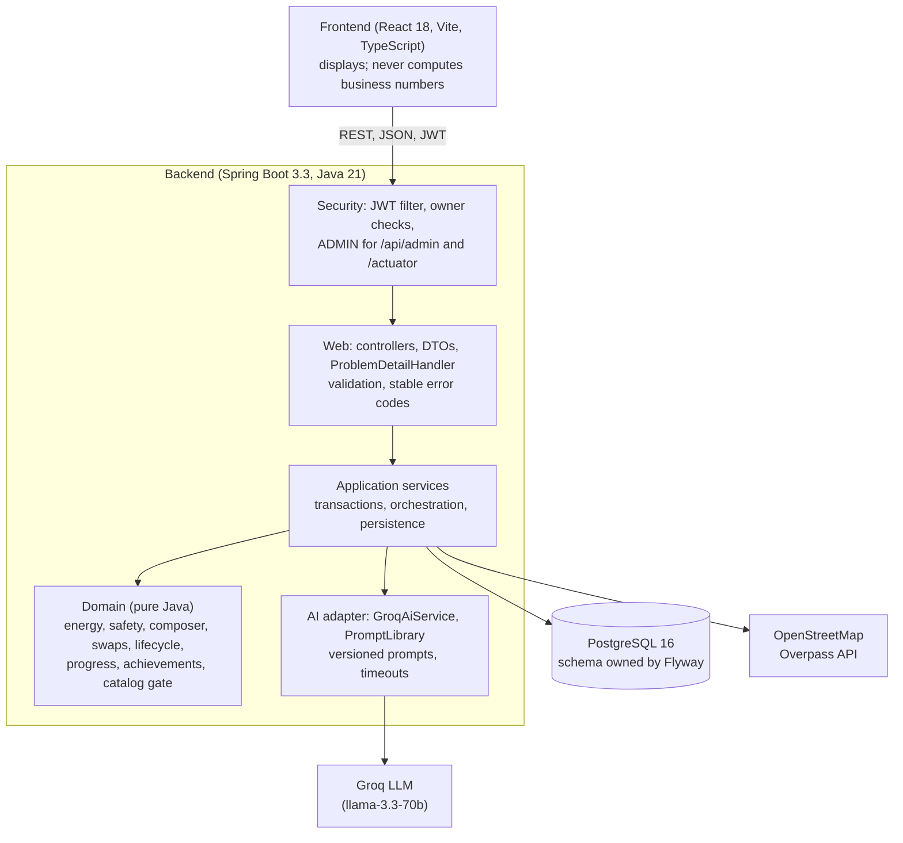
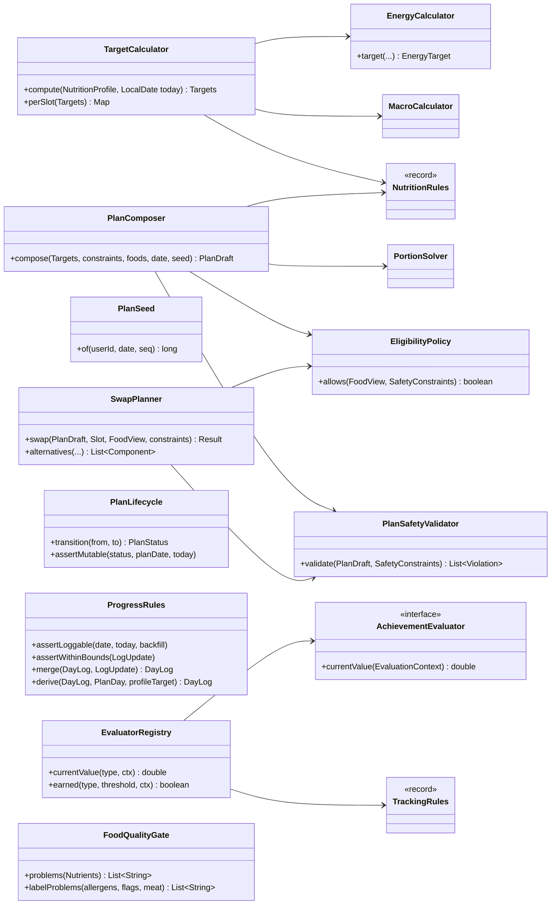
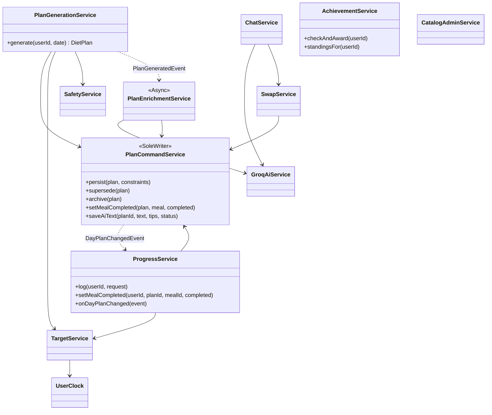

# NutriCook — Architecture and Class Diagram

**Version**: 2.0.0 | **Date**: 2026-10-11

> How the backend is layered and where each business rule lives. Tables are in
> [`data-model.md`](data-model.md), runtime flows in [`sequence-diagrams.md`](sequence-diagrams.md)
> and the rules themselves in [`../domain/business-rules.md`](../domain/business-rules.md).

---

## 1. Layers

The arrows are the only allowed dependencies. ArchUnit (`ArchitectureTest`) fails the build if:

- `com.nutricook.domain..` depends on Spring, JPA, the web layer or the system clock
  (Constitution IV, BR-TIM-03);
- any class other than `PlanCommandService` saves a plan (BR-SAF-05: nothing unsafe is persisted).

---

## 2. The domain core

Everything that decides something lives here, as plain Java with injected time and tunables.
It is tested without Spring: unit, table-driven and property-based (jqwik) tests.

| Package | Rules | Key idea |
|---|---|---|
| `domain.energy` | BR-NRG, BR-MAC | Mifflin-St Jeor, goal adjustment, a floor that rounding never breaks |
| `domain.safety` | BR-SAF | Allergens, diet flags and condition limits; unknown data fails closed |
| `domain.plan` | BR-CMP, BR-LIF, BR-AI-03 | Seeded composer, portion solver, role-based swaps, lifecycle state machine |
| `domain.progress` | BR-PRG | Date window, bounds, merge, derived calories, target snapshot |
| `domain.achievement` | BR-ACH | One evaluator per type, registry that fails startup when one is missing |
| `domain.catalog` | BR-CAT-02 | Energy matches macros, labels match the food |
| `domain.rules` | §13 | Every tunable (`app.nutrition.*`, `app.tracking.*`), range-checked at startup |

---

## 3. Application services

- **One writer.** `PlanCommandService` (`<<SoleWriter>>`) is the only class that saves plans.
- **Events instead of cycles.** `PlanCommandService` publishes `DayPlanChangedEvent` after it saves
  or archives a plan; `ProgressService` handles it in the same transaction, so a day's entry always
  follows its plan. `PlanGeneratedEvent` is handled only after commit, so the AI never delays or
  breaks plan creation (BR-LIF-07).
- **Lost updates avoided.** The AI text arrives asynchronously, so it is written with targeted
  `UPDATE`s of its own columns, never by saving the whole plan row.

---

## 4. Web and security

| Area | Classes | Notes |
|---|---|---|
| Endpoints | `AuthController`, `ProfileController`, `TargetController`, `DietController`, `ProgressController`, `AchievementController`, `LocationController`, `ReferenceController`, `AdminFoodController` | Every `/api/users/{userId}/**` endpoint checks ownership (`@security.isOwner`) |
| Errors | `ProblemDetailHandler`, `ProblemDetailSecurityHandlers` | RFC 9457 bodies with a stable `code` and the request id |
| Security | `JwtAuthFilter`, `JwtService`, `SecurityConfig`, `JwtSecretValidator` | Stateless JWT; prod refuses weak or published secrets |
| Operations | `CorrelationIdFilter`, `CatalogStartupCheck`, Actuator | `X-Request-Id` everywhere; bad catalog data stops startup; metrics for admins |
