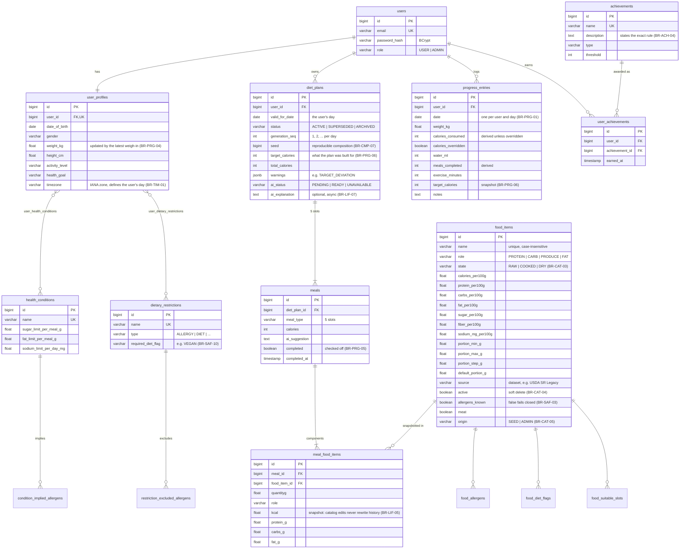

# NutriCook — Data Model

**Version**: 2.0.0 | **Date**: 2026-10-11 | **Schema**: Flyway V1–V8 + `R__food_catalog`

> The schema belongs to the Flyway migrations in `backend/src/main/resources/db/migration`
> (Constitution VI); Hibernate only validates it. This page is a reading aid: the migrations win
> when they disagree. Rules are referenced by their IDs in
> [`docs/domain/business-rules.md`](../domain/business-rules.md).

---

## 1. Entity–relationship diagram

The five collection tables (`food_allergens`, `food_diet_flags`, `food_suitable_slots`,
`condition_implied_allergens`, `restriction_excluded_allergens`) hold one enum value per row.

---

## 2. Constraints that enforce business rules

The application checks every rule first; these constraints are the last line of defense
(defense in depth), so even a bug or a manual edit cannot store an invalid state.

| Constraint | Table | Rule |
|---|---|---|
| `ux_active_plan` (partial unique on `user_id, valid_for_date` where `ACTIVE`) | `diet_plans` | One ACTIVE plan per user-day, even under concurrent generation (BR-LIF-02) |
| `ck_diet_plans_status`, `ck_diet_plans_ai_status` | `diet_plans` | Lifecycle states (BR-LIF-01, BR-LIF-07) |
| `uq_user_progress_date` | `progress_entries` | One entry per user and day (BR-PRG-01) |
| `ck_progress_*` (calories, water, exercise, weight, notes, meals, target) | `progress_entries` | Bounds (BR-PRG-03) |
| `ck_meals_completed_at` | `meals` | `completed_at` only on checked meals (BR-PRG-05) |
| `uq_user_achievement` | `user_achievements` | Awards are unique; inserts use `ON CONFLICT DO NOTHING` (BR-ACH-06) |
| `ck_achievements_type` | `achievements` | Only measurable types (BR-ACH-05) |
| `uq_food_items_name`, `ux_food_items_name_ci` | `food_items` | Unique names, ignoring case (BR-CAT-01) |
| `ck_food_items_origin` | `food_items` | SEED or ADMIN (BR-CAT-05) |
| `ck_mfi_role` | `meal_food_items` | Component roles (BR-CMP-02) |

---

## 3. Migration history

| Migration | What it does |
|---|---|
| `V1__baseline` | The original schema, captured as the first migration |
| `V2__profile_timezone` | `user_profiles.timezone`: "today" is the user's day (BR-TIM-01) |
| `V3__food_attributes` | Food roles, states, portions, allergens, diet flags, slots and sources (BR-CAT, BR-SAF) |
| `V4__reference_data` | Restrictions, conditions and achievements as data, with the allergens they exclude or imply |
| `V5__plan_lifecycle` | SUPERSEDED status, `ux_active_plan`, seed and sequence, warnings, AI status, component snapshots |
| `V6__progress_meal_completion` | Meal check-off, plan target, progress override and target snapshot, progress bounds |
| `V7__achievement_types` | `LOGGING_STREAK`, PROTEIN_GOAL removed, rule-stating descriptions, weight milestones |
| `V8__food_origin` | `origin` SEED/ADMIN, case-insensitive unique names |
| `R__food_catalog` | The curated catalog, generated from `db/catalog/foods.csv`; touches SEED rows only |

Every versioned migration was also applied to a database holding earlier data, not only to an
empty one, and the upgraded rows were checked.
