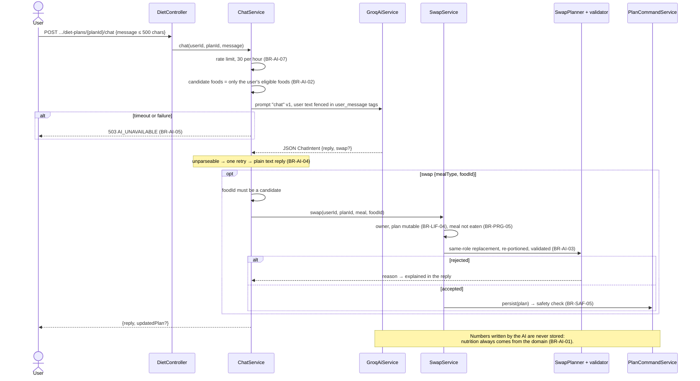

# NutriCook — Sequence Diagrams

**Version**: 2.0.0 | **Date**: 2026-10-11

> The main runtime flows as built. Rule IDs refer to
> [`../domain/business-rules.md`](../domain/business-rules.md).

---

## SD-01 — Register and sign in

```mermaid
sequenceDiagram
    actor U as User
    participant FE as Frontend
    participant API as AuthController
    participant S as AuthService
    participant DB as PostgreSQL

    U->>FE: email + password
    FE->>API: POST /api/auth/register
    API->>S: register(request)
    S->>DB: email taken? (unique)
    alt already registered
        S-->>FE: 409 EMAIL_TAKEN
    else new
        S->>DB: insert user (BCrypt hash) + empty profile
        S-->>FE: 201 {userId, token}
    end
    Note over FE,API: Later calls send "Authorization: Bearer <token>".<br/>JwtAuthFilter loads the user and role on every request;<br/>/api/users/{id}/** also checks that id is the caller (Constitution VII).
```

---

## SD-02 — Generate a plan: commit first, AI afterwards

```mermaid
sequenceDiagram
    actor U as User
    participant C as DietController
    participant G as PlanGenerationService
    participant D as Domain (TargetCalculator,<br/>PlanComposer, validator)
    participant CMD as PlanCommandService
    participant P as ProgressService
    participant DB as PostgreSQL
    participant E as PlanEnrichmentService
    participant AI as Groq

    U->>C: POST /api/users/{id}/diet-plans/generate[?date]
    C->>G: generate(userId, date)
    G->>G: user's today from the profile timezone (BR-TIM-01)
    G->>G: date within [today, today+7] (BR-LIF-03), daily quota (BR-LIF-06)
    G->>D: targets from the profile (BR-NRG, BR-MAC)
    G->>D: eligible foods: allergens, flags, conditions (BR-SAF)
    G->>D: compose(targets, foods, date, seed = f(user, date, seq))
    D-->>G: PlanDraft (deterministic, validated, warnings)
    G->>CMD: supersede the day's ACTIVE plan (BR-LIF-02)
    G->>CMD: persist(new plan)
    CMD->>D: PlanSafetyValidator.validate (BR-SAF-05)
    CMD->>DB: insert plan, meals, component snapshots
    CMD-)P: DayPlanChangedEvent (same transaction)
    P->>DB: refresh the day's progress entry, if any
    G-)E: PlanGeneratedEvent
    Note over G,DB: commit (ux_active_plan keeps one ACTIVE plan;<br/>a concurrent duplicate is retried once)
    C-->>U: 201 plan, aiStatus = PENDING
    Note over E: runs only after commit, on a bounded executor
    E->>AI: explanation + meal tips (versioned prompts, timeout)
    alt AI answers
        E->>CMD: saveAiText(...) → READY
    else timeout or error
        E->>CMD: saveAiText(...) → UNAVAILABLE
    end
    CMD->>DB: UPDATE only the AI columns (no lost update)
    U->>C: GET plan (the frontend polls while PENDING)
```

---

## SD-03 — Chat: the AI proposes, the domain decides



The manual swap menu (`GET .../alternatives`, `POST .../swap`) uses the same `SwapService`.

---

## SD-04 — Check a meal off: progress and achievements follow

```mermaid
sequenceDiagram
    actor U as User
    participant C as DietController
    participant P as ProgressService
    participant CMD as PlanCommandService
    participant R as ProgressRules
    participant A as AchievementService
    participant EV as EvaluatorRegistry
    participant DB as PostgreSQL

    U->>C: PUT .../meals/{mealId}/completion {completed: true}
    C->>P: setMealCompleted(...)
    P->>R: plan day within [today − 30, today] (BR-PRG-02)
    P->>CMD: setMealCompleted(plan, meal) — ACTIVE plans only
    P->>R: derive(day): meals checked, calories = their sum<br/>unless typed by the user; target from the plan (BR-PRG-05/06)
    P->>DB: upsert the day's entry
    C->>A: checkAndAward(userId)
    A->>DB: profile, 365 days of entries, first weigh-in,<br/>distinct plan days, awards, catalog (fixed number of queries, BR-ACH-07)
    A->>EV: currentValue per achievement (BR-ACH-01..05)
    A->>DB: INSERT ... ON CONFLICT DO NOTHING (BR-ACH-06)
    C-->>U: {plan, progress, newAchievements}
```

Logging progress (`POST .../progress`) follows the same path through `ProgressRules`: merge only
the fields sent (BR-PRG-01), check bounds (BR-PRG-03), and update the profile weight when the
weigh-in is the latest one (BR-PRG-04).

---

## SD-05 — Curate the food catalog

```mermaid
sequenceDiagram
    actor A as Admin
    participant C as AdminFoodController
    participant S as CatalogAdminService
    participant G as FoodQualityGate
    participant DB as PostgreSQL

    A->>C: POST /api/admin/foods (role ADMIN, BR-CAT-05)
    C->>S: create(request)
    S->>DB: name free, ignoring case? (BR-CAT-01)
    S->>G: energy matches macros, labels match the food (BR-CAT-02)
    alt problems
        S-->>A: 400 VALIDATION_FAILED, every problem listed
    else clean
        S->>DB: insert, origin = ADMIN
        S-->>A: 201 food
    end
    A->>C: DELETE /api/admin/foods/{id}
    C->>S: deactivate → active = false (BR-CAT-04)
    Note over S,DB: Past plans keep their component snapshots;<br/>new plans and swaps no longer offer the food.
```

At startup, `CatalogStartupCheck` runs the same gate on every active food and refuses to start,
naming the food, if one fails.

---

## SD-06 — Find nearby restaurants

```mermaid
sequenceDiagram
    actor U as User
    participant FE as Frontend
    participant C as LocationController
    participant L as LocationService
    participant OSM as Overpass (main, then mirror)

    U->>FE: allow location
    FE->>C: GET /api/location/restaurants?lat&lng
    C->>L: getNearbyRestaurants(lat, lng)
    L->>L: snap to a ~100 m grid; cache hit? (Caffeine, 1 h)
    loop main server, then mirror
        L->>OSM: Overpass query (15 s server timeout)
        OSM-->>L: JSON places, or an error page
    end
    alt a server answered JSON
        L-->>FE: name, type, coordinates (cached)
    else every server failed
        L-->>FE: 503 MAP_UNAVAILABLE (not cached, the next request retries)
    end
```
