# NutriCook — Use Case Diagram

**Version**: 2.0.0 | **Date**: 2026-10-11

> Rule IDs refer to [`../domain/business-rules.md`](../domain/business-rules.md); the flows are
> drawn in [`sequence-diagrams.md`](sequence-diagrams.md).

---

## Actors

| Actor | Description |
|---|---|
| **Guest** | Unauthenticated visitor — can only register or log in |
| **User** | Authenticated NutriCook user with a complete profile |
| **Admin** | A user with the ADMIN role: curates the food catalog (BR-CAT-05) |
| **Groq AI** | External AI service — invoked by the system to generate meal content |
| **OSM APIs** | OpenStreetMap's Overpass API — invoked for location features |

---

## Use Case Diagram

```mermaid
graph TD
    subgraph System["NutriCook System"]

        subgraph Auth["Authentication"]
            UC1[Register]
            UC2[Login]
            UC3[Logout]
        end

        subgraph Profile["Profile Management"]
            UC4[Create / Update Profile]
            UC5[Set Health Conditions]
            UC6[Set Dietary Restrictions]
        end

        subgraph Diet["Diet Planning"]
            UC7[Generate Diet Plan]
            UC8[View Diet Plan]
            UC9[Archive Diet Plan]
            UC10[View Meal Details]
        end

        subgraph AI["AI Features"]
            UC11[Get AI Meal Suggestion]
            UC12[Get AI Plan Explanation]
            UC21[Chat with the AI Dietitian]
        end

        subgraph Changes["Plan Changes"]
            UC22[Swap a Food]
            UC23[Check a Meal Off]
        end

        subgraph Catalog["Catalog Administration"]
            UC24[Curate Food Catalog]
        end

        subgraph Nutrition["Nutrition"]
            UC13[View Nutrition Breakdown]
            UC14[View Food Item Details]
        end

        subgraph Progress["Progress & Achievements"]
            UC15[Log Daily Progress]
            UC16[View Weekly Progress]
            UC17[View Achievements]
        end

        subgraph Location["Location"]
            UC18[Find Nearby Restaurants]
            UC19[Find Nearby Grocery Stores]
            UC20[View Location on Map]
        end

    end

    Guest --> UC1
    Guest --> UC2

    User --> UC2
    User --> UC3
    User --> UC4
    User --> UC5
    User --> UC6
    User --> UC7
    User --> UC8
    User --> UC9
    User --> UC10
    User --> UC13
    User --> UC14
    User --> UC15
    User --> UC16
    User --> UC17
    User --> UC18
    User --> UC19
    User --> UC20
    User --> UC21
    User --> UC22
    User --> UC23
    Admin --> UC24

    UC21 -.->|may include| UC22
    UC23 -.->|updates| UC15

    UC7 -.->|then, async| UC11
    UC7 -.->|then, async| UC12
    UC7 -.->|includes| UC13

    UC11 -.->|uses| GroqAI([Groq AI])
    UC12 -.->|uses| GroqAI
    UC21 -.->|uses| GroqAI

    UC18 -.->|uses| OSM([OSM Overpass API])
    UC19 -.->|uses| OSM
    UC20 -.->|uses| OSM
```

---

## Use Case Specifications

### UC1 — Register

| Field | Detail |
|---|---|
| **Actor** | Guest |
| **Precondition** | User is not authenticated |
| **Main Flow** | 1. Guest submits email + password → 2. System validates email uniqueness → 3. System BCrypt-hashes password → 4. User record created → 5. Empty UserProfile created → 6. JWT returned |
| **Alternative Flow** | Email already taken → 400 with field error |
| **Postcondition** | User is authenticated; empty profile awaits completion |

---

### UC2 — Login

| Field | Detail |
|---|---|
| **Actor** | Guest / User |
| **Precondition** | User has a registered account |
| **Main Flow** | 1. Submit email + password → 2. System loads User by email → 3. BCrypt verification → 4. JWT (24h) returned |
| **Alternative Flow** | Invalid credentials → 401 |
| **Postcondition** | JWT stored in frontend localStorage |

---

### UC4 — Create / Update Profile

| Field | Detail |
|---|---|
| **Actor** | User |
| **Precondition** | Authenticated |
| **Main Flow** | 1. Submit firstName, lastName, dateOfBirth, gender, weightKg, heightCm, activityLevel, healthGoal → 2. System validates ranges → 3. UserProfile saved |
| **Alternative Flow** | Invalid weight or height range → 422 |
| **Postcondition** | Profile complete; user can generate diet plans |

---

### UC7 — Generate Diet Plan *(core use case)*

| Field | Detail |
|---|---|
| **Actor** | User |
| **Precondition** | Profile complete and eligible (BR-PRF-01/02): date of birth, gender, weight, height, activity level, goal |
| **Main Flow** | 1. User asks for today's plan, or a day up to 7 days ahead (BR-LIF-03) → 2. System checks the daily generation quota (BR-LIF-06) → 3. Computes energy and macro targets (BR-NRG, BR-MAC) → 4. Keeps only foods that are safe for the user's allergies, diets and conditions (BR-SAF) → 5. Composes 5 meals deterministically from a seed (BR-CMP) → 6. Validates the whole plan; nothing unsafe is saved (BR-SAF-05) → 7. Supersedes the day's previous ACTIVE plan (BR-LIF-02) and saves the new one with nutrition snapshots (BR-LIF-05) → 8. Returns at once; **then** UC11 and UC12 add AI text in the background (BR-LIF-07) |
| **Alternative Flow** | Profile incomplete → `PROFILE_INCOMPLETE` listing the missing fields · no safe plan possible → `PLAN_INFEASIBLE` explaining which constraint · quota reached → `GENERATION_LIMIT` · AI slow or down → the plan is complete without AI text (`aiStatus = UNAVAILABLE`) |
| **Postcondition** | Exactly one ACTIVE plan for that user and day |

---

### UC11 — Get AI Meal Suggestion

| Field | Detail |
|---|---|
| **Actor** | System (included by UC7) |
| **Precondition** | Meal object constructed; user profile available |
| **Main Flow** | 1. After the plan is committed, the system renders the versioned prompt `prompts/meal-suggestion.st` (BR-AI-08) → 2. Calls Groq with a timeout (BR-AI-05) → 3. Stores the text as `meal.aiSuggestion`; only the AI columns are written |
| **Alternative Flow** | Timeout or error → no tip, `aiStatus = UNAVAILABLE`; the plan is unaffected |

---

### UC15 — Log Daily Progress

| Field | Detail |
|---|---|
| **Actor** | User |
| **Precondition** | Authenticated |
| **Main Flow** | 1. User submits a date within the last 30 days (BR-PRG-02) and any of: weight, calories, water, exercise, notes → 2. Values are checked against their bounds; every invalid field is reported (BR-PRG-03) → 3. Merged into the day's entry: omitted fields keep their value (BR-PRG-01) → 4. Calories typed by the user override the meal-based count until reset (BR-PRG-05) → 5. The latest weigh-in updates the profile weight (BR-PRG-04) → 6. Achievements are evaluated (BR-ACH) |
| **Postcondition** | One entry for that day, with its target snapshot (BR-PRG-06); new achievements awarded once (BR-ACH-06) |

---

### UC21 — Chat with the AI Dietitian

| Field | Detail |
|---|---|
| **Actor** | User |
| **Main Flow** | 1. User writes up to 500 characters (BR-AI-06) → 2. The AI sees only foods the user may eat (BR-AI-02) and answers with a structured intent (BR-AI-04) → 3. A proposed swap goes through UC22 like a manual one |
| **Alternative Flow** | More than 30 messages per hour → `RATE_LIMITED` (BR-AI-07) · AI down → `AI_UNAVAILABLE` (BR-AI-05) |

---

### UC22 — Swap a Food

| Field | Detail |
|---|---|
| **Actor** | User (from the meal's swap menu, or through UC21) |
| **Main Flow** | 1. User picks a safe alternative with the same role → 2. The domain re-portions it and revalidates the plan (BR-AI-03, BR-SAF-05) |
| **Alternative Flow** | Past, superseded or archived plan → `PLAN_READ_ONLY` (BR-LIF-04) · meal already checked off → `SWAP_REJECTED` (BR-PRG-05) |

---

### UC23 — Check a Meal Off

| Field | Detail |
|---|---|
| **Actor** | User |
| **Main Flow** | 1. User marks a meal of the day's ACTIVE plan as eaten → 2. The day's entry counts checked meals and, unless typed by the user, adds up their calories (BR-PRG-05) → 3. Achievements are evaluated |

---

### UC24 — Curate Food Catalog

| Field | Detail |
|---|---|
| **Actor** | Admin |
| **Main Flow** | 1. Admin creates or edits a food: per-100 g values, portions, allergens, diet flags, slots, source → 2. The quality gate checks energy against macros and labels against the food (BR-CAT-02) → 3. Foods are deactivated, never deleted (BR-CAT-04) |
| **Alternative Flow** | Gate fails → every problem listed · seeded food → only (de)activation (`FOOD_READ_ONLY`) |

---

### UC18 — Find Nearby Restaurants

| Field | Detail |
|---|---|
| **Actor** | User |
| **Precondition** | Browser geolocation permission granted |
| **Main Flow** | 1. Frontend sends lat/lng + dietaryRestrictions → 2. Backend checks Caffeine cache (1h TTL) → cache miss: calls Overpass API for restaurant nodes within 2km → 3. Results filtered and enriched → 4. Returned as GeoJSON-compatible list → 5. Rendered on Leaflet map |
| **Alternative Flow** | Overpass API unreachable → cached result or empty list with user message |
